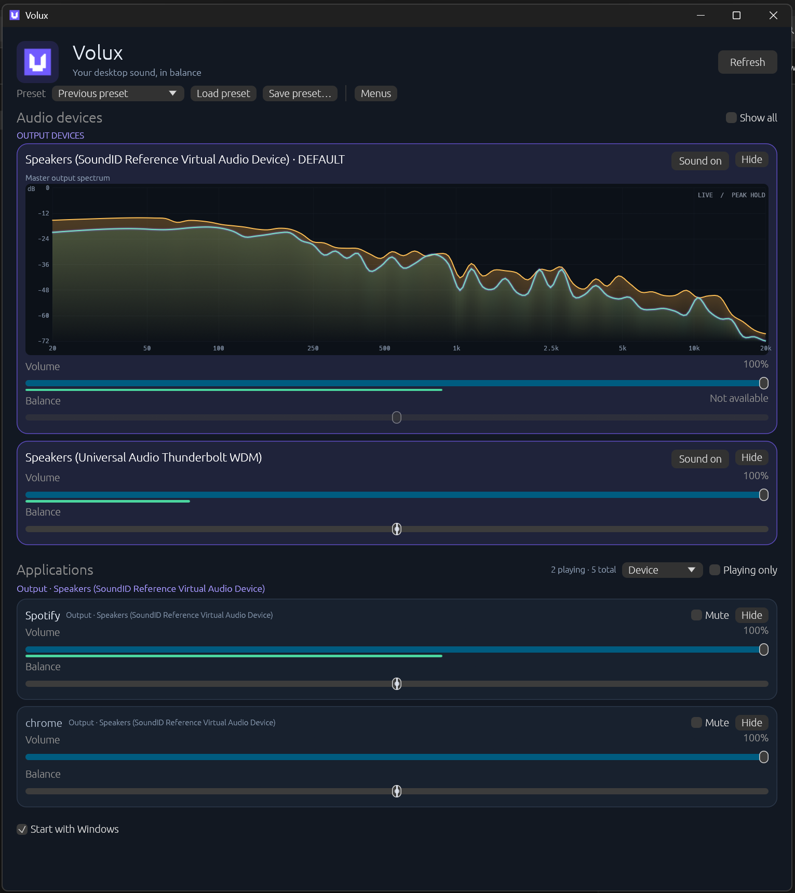

# Volux

A small Windows x64 audio mixer written in Rust. It controls active playback and recording devices and their application sessions.



## Features

- Per-device output and input volume and mute
- Per-application volume and mute
- Stereo left/right balance
- Live per-device and per-application peak meters
- Numeric left/right balance with center snap and reset
- Group applications by audio device or application
- Multiple named presets with save and apply controls
- Shortcuts to the Windows mixer and classic Sound control panel
- Matching window, tray, and executable icon
- Start with Windows
- System tray menu
- Per-user installer with no administrator requirement

Applications without Windows Core Audio stereo channel control show balance as unavailable.

## Build

Requirements:

- Rust for the `x86_64-pc-windows-msvc` target
- Visual Studio C++ build tools

```powershell
cargo fmt
cargo test
cargo build --release
```

The release executable is written to `target\release\volux.exe`.

## Installer

With Inno Setup 6 installed, compile `installer\volux.iss` in Inno Setup or run `ISCC.exe installer\volux.iss`. The installer is written to `dist`.

## Notes

Volux uses a normal per-user Windows app. It does not install or run a service, and it only modifies `HKCU` when Start with Windows is enabled. Settings are stored under the user's roaming application-data folder.
